<p align="center">
  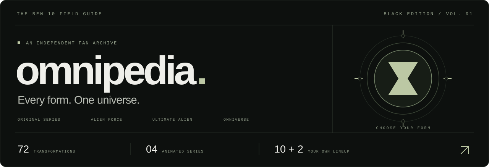
</p>

<p align="center">
  A fan-made <strong>React JavaScript Ben 10 encyclopedia</strong> with a matte black interface,<br />
  281 curated images, detailed transformation files, comparisons, and your own named Omnitrix lineups.
</p>

<p align="center">
  <a href="https://github.com/PRABHMANNAT/Ben-10-Omnitrix-Database/stargazers"></a>
  <a href="https://github.com/PRABHMANNAT/Ben-10-Omnitrix-Database/forks"></a>
  
  
</p>

<p align="center">
  <a href="#the-field-guide">Features</a> ·
  <a href="#see-every-form-in-action">Image galleries</a> ·
  <a href="#ten-picks-two-wildcards">Team builder</a> ·
  <a href="#inside-the-archive">Screenshots</a> ·
  <a href="#run-it-locally">Quick start</a> ·
  <a href="#make-the-archive-better">Contribute</a>
</p>

<a href="docs/assets/archive.jpg">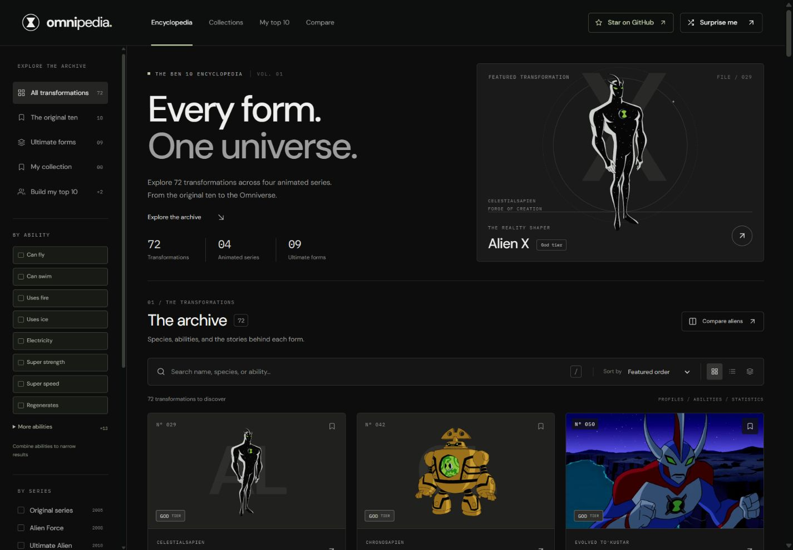</a>

## The field guide

From Heatblast to Alien X. Browse **72 transformations** across **Original Series, Alien Force, Ultimate Alien, and Omniverse**, including **nine Ultimate forms**. Explore an alien's species, homeworld, abilities, weaknesses, first appearance, and statistics in a dedicated dossier.

<table>
  <tr>
    <td width="50%" valign="top">
      <br />
      <strong>Find your next form</strong><br />
      Search names, species, and abilities. Combine 21 ability filters with series, tier, classification, or stats. Switch between grid, list, and tier views.
    </td>
    <td width="50%" valign="top">
      <br />
      <strong>Build your own Omnitrix</strong><br />
      Create and name multiple teams. Rank ten transformations, add two optional bonus picks, and switch, copy, or rename your lineups. Duplicate picks within a team are prevented.
    </td>
  </tr>
  <tr>
    <td valign="top">
      <br />
      <strong>Settle the friendly debate</strong><br />
      Compare two or three forms across ten stats, power tiers, and homeworlds. Highest values are highlighted for a quick read.
    </td>
    <td valign="top">
      <br />
      <strong>Keep your favorites close</strong><br />
      Bookmark a personal collection. Your collection and team are saved in this browser, with no account or backend to configure.
    </td>
  </tr>
</table>

The Black Edition pairs charcoal surfaces, rounded character cards and controls, sage highlights, and muted blue ability filters. A sliding navigation pill follows your current section and respects reduced-motion preferences. The Omnitrix identity includes SVG, multi-size ICO, and Apple touch icons, with a **Built by Prabhmannat Singh** credit in the sidebar. Responsive layouts, keyboard navigation, and focus-managed dialogs are built into the experience. Press **`/`** to search the archive or **`Esc`** to close a dialog.

<details>
  <summary><strong>See the latest interface refinements</strong></summary>
  <br />
  <a href="docs/assets/rounded-interface.jpg">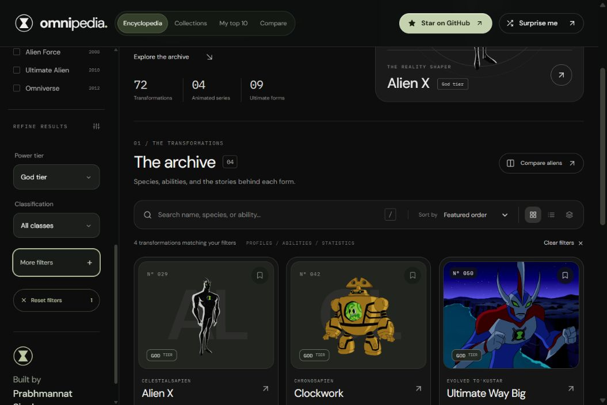</a>
  <br />
  <table><tr>
    <td width="72%" valign="top">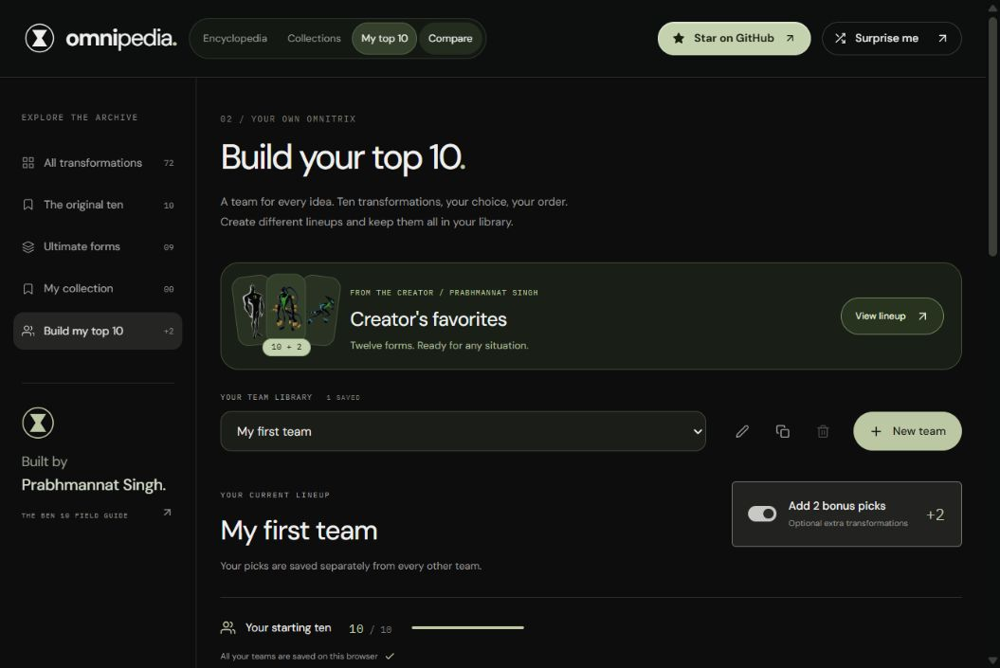</td>
    <td width="28%" valign="top">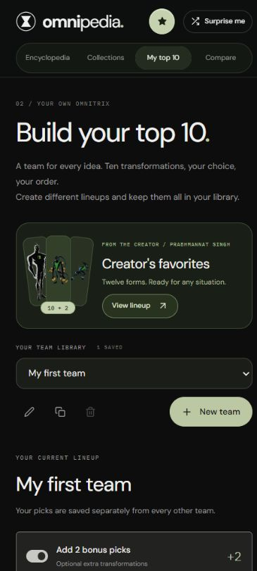</td>
  </tr></table>
</details>

### Find a form for the job

Use **By ability** on the home screen or in the team picker. Start with **Can fly**, **Can swim**, **Uses fire**, or **Uses ice**. More options cover electricity, strength, speed, regeneration, water, plants, energy absorption, invisibility, phasing, shape-shifting, duplication, technology, mind powers, time, gravity, teleportation, and sonic attacks.

Selections combine: **Can fly + Uses fire** shows forms with both powers. Ability filters also work alongside search and series filters, with clear controls to reset them. Both search boxes understand phrases such as **can fly**, **can swim**, and **use fire**.

Matches come from the archive's listed abilities. Weaknesses and elemental immunities do not grant an active power; “Can swim” also includes listed underwater breathing or movement.

<details>
  <summary><strong>See combined ability filters in action</strong></summary>
  <br />
  <a href="docs/assets/archive-abilities.jpg">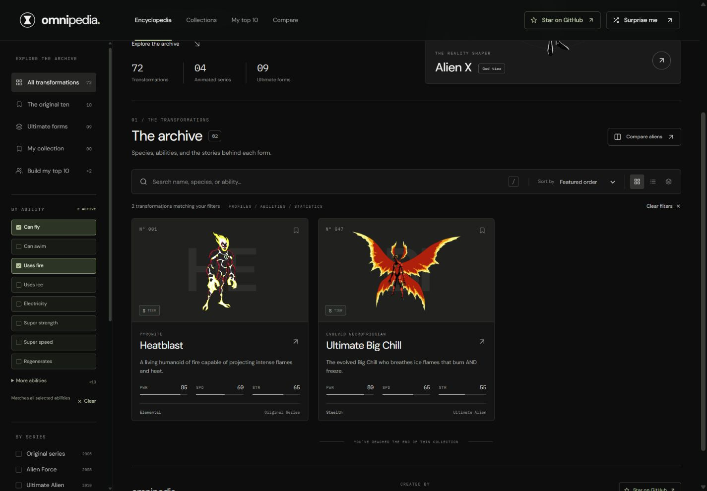</a>
</details>

## See every form in action

Open an alien’s dossier and choose **Gallery**. Explore **281 locally hosted images across all 72 aliens**, with **three or four images per transformation**: alternate series designs, power demonstrations, episode stills, and game appearances where available. Galleries open on an action shot when one is available.

Select a thumbnail or use the image arrows; **← / →**, **Home**, and **End** work while a gallery control is focused. Open **Full resolution** for the complete image, or **Source & credits** for its original file page. Images keep their aspect ratio and are loaded when you open a gallery.

<a href="docs/assets/gallery-desktop.jpg">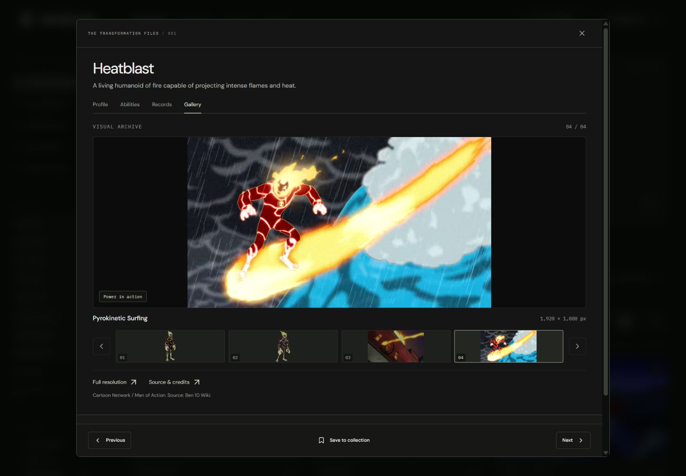</a>

Most sources retain their native resolution, including HD episode frames. **Eight smaller images are AI-enhanced** and visibly labeled, with original dimensions and a comparison link. The viewer always shows actual pixel dimensions. **Sandbox and Snakepit use explicitly labeled non-canon Thomas N. Perkins IV concepts**, including scale charts and isolated versions; Portaler’s gameplay and concepts are labeled separately. See the [image sources, credits, and enhancement notes](docs/GALLERY_SOURCES.md).

<details>
  <summary><strong>Gallery on mobile</strong></summary>
  <br />
  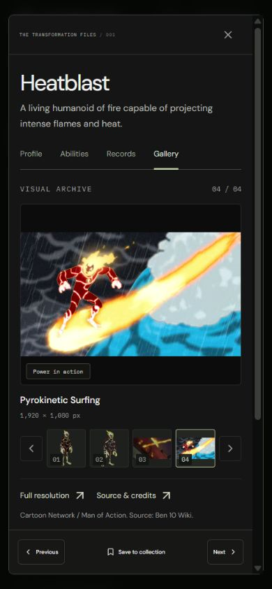
</details>

## Ten picks. Two wildcards.

Your Omnitrix, your rules. Open **My top 10** and use **New team** to name a lineup. Each team keeps its own ranked ten, two optional bonus picks, and bonus toggle. Switch between teams from **Your team library**, or use the rename, duplicate, and delete controls beside it. Your original saved team is upgraded automatically.

Select a slot to choose a transformation and use the arrows to change its rank. Enable **Add 2 bonus picks** to give that team a little extra range. A deletion asks for confirmation and keeps at least one personal team available.

<a href="docs/assets/team-builder.jpg">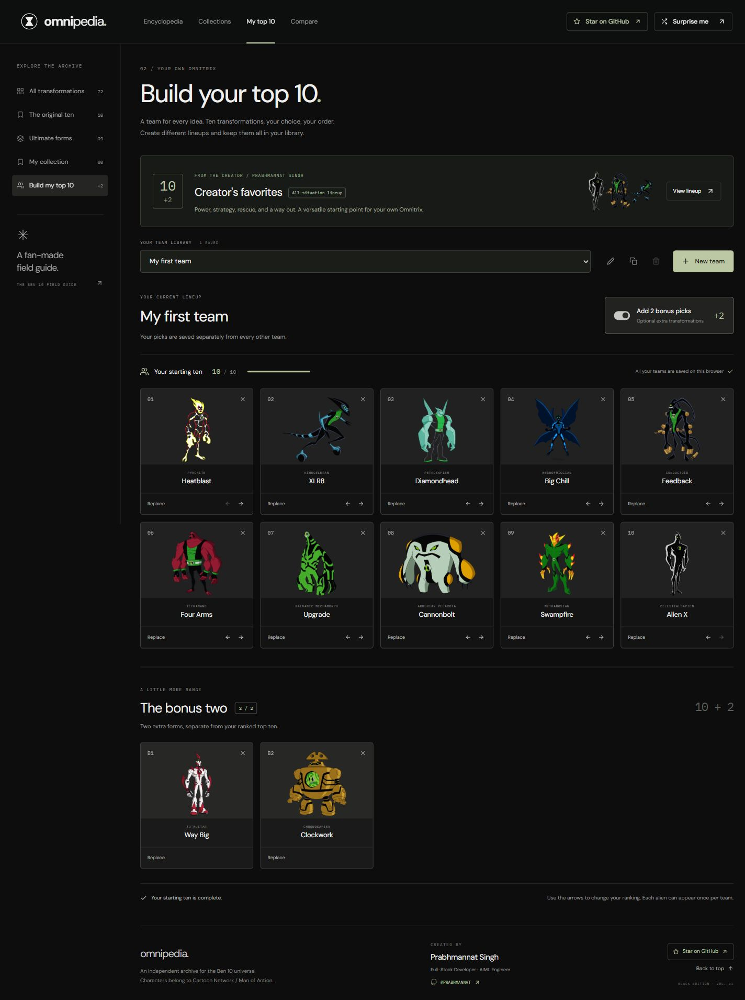</a>

<p align="center"><sub>A sample lineup captured in the running app. Team choices are saved locally on your own browser.</sub></p>

### Creator's favorites

Start with **Prabhmannat Singh's** built-in **Creator's favorites** preset: ten versatile picks for different situations, plus **Way Big** and **Ultimate Echo Echo** in reserve. The main ten are **Alien X, Clockwork, Atomix, Feedback, Gravattack, Big Chill, Upgrade, Grey Matter, Swampfire, and XLR8**.

Each pick has a role, with an expandable **Why these twelve?** guide covering strengths and trade-offs. Select **View lineup** to explore it, then **Make it yours** to create an editable copy. The original preset stays available.

<details>
  <summary><strong>See the complete creator lineup</strong></summary>
  <br />
  <a href="docs/assets/creator-team.jpg">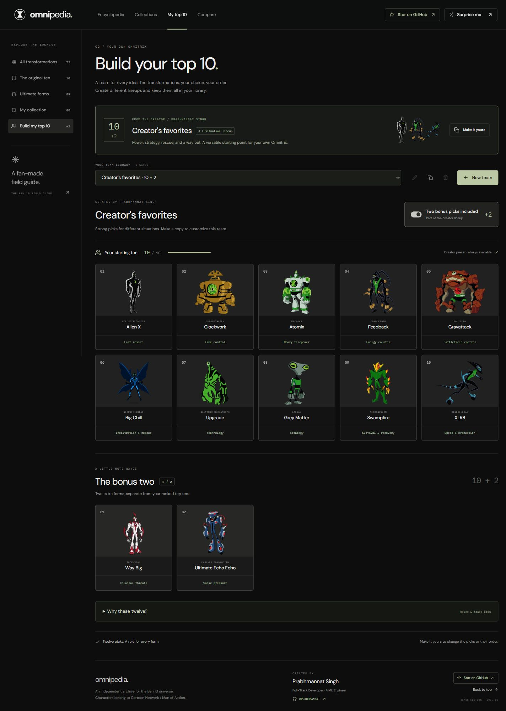</a>
</details>

## Inside the archive

Real screenshots from the Black Edition. Select an image to see it at full size.

<table>
  <tr>
    <td width="50%"><a href="docs/assets/profile.jpg">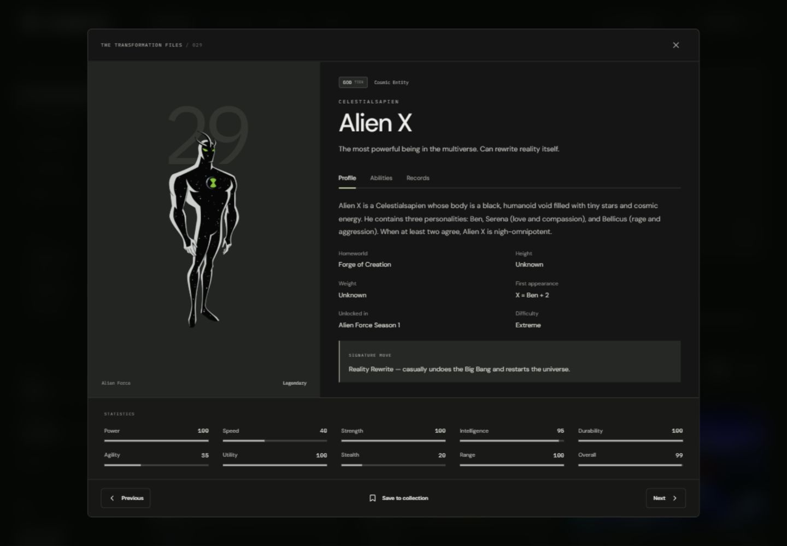</a><br /><strong>01 / Transformation files</strong></td>
    <td width="50%"><a href="docs/assets/comparison.jpg">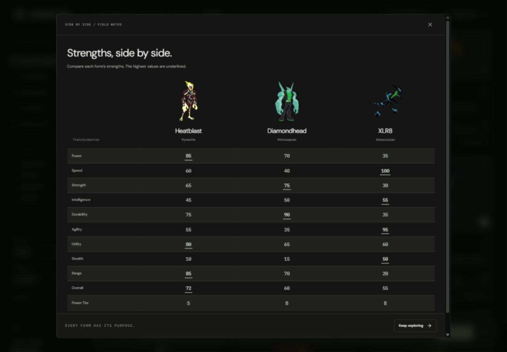</a><br /><strong>02 / Side-by-side comparisons</strong></td>
  </tr>
</table>

<details>
  <summary><strong>More screenshots — team picker and mobile layout</strong></summary>
  <br />
  <table>
    <tr>
      <td width="72%" valign="top"><a href="docs/assets/team-picker.jpg">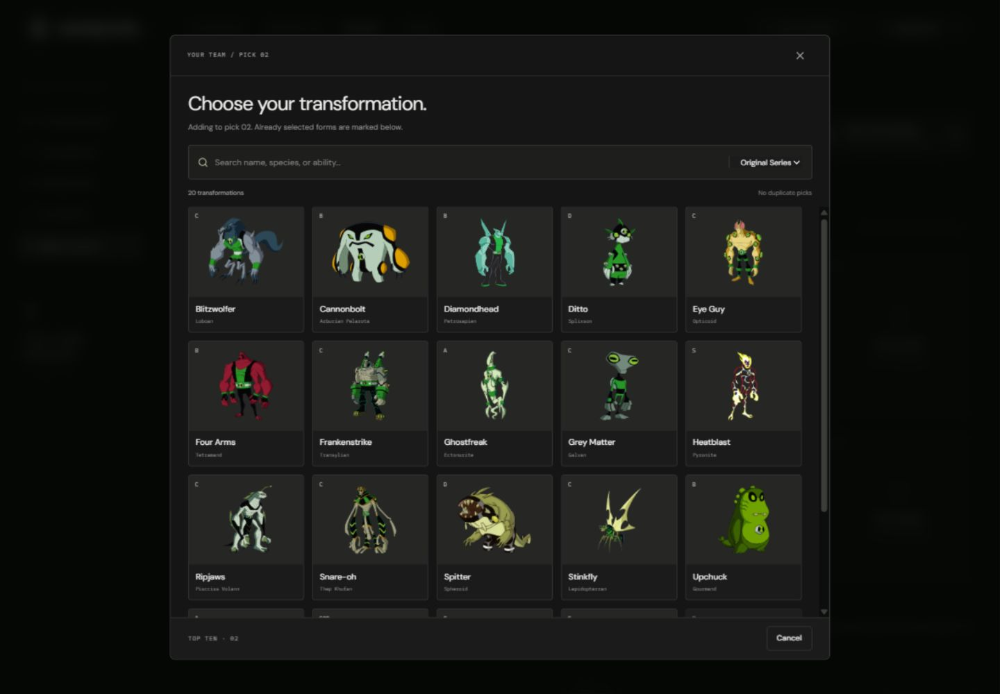</a><br /><strong>03 / Choose your transformation</strong></td>
      <td width="28%" valign="top"><a href="docs/assets/mobile.jpg">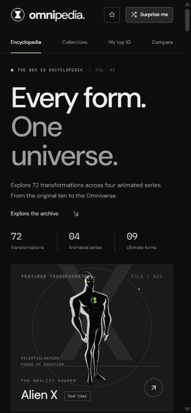</a><br /><strong>04 / On the go</strong></td>
    </tr>
  </table>
</details>

## Run it locally

Use **Node.js 22.12+** and npm. Node.js 24 is also supported.
The Node requirement is declared in `package.json`; `.nvmrc` selects the Node 22 release line.

```bash
git clone https://github.com/PRABHMANNAT/Ben-10-Omnitrix-Database.git
cd Ben-10-Omnitrix-Database
npm ci
npm run dev
```

Open the local URL printed by Vite, usually **http://localhost:5173**. No API keys, environment variables, database, or sign-in are needed.

| Command | Purpose |
| :--- | :--- |
| `npm run dev` | Start the development server with hot reload |
| `npm start` | Alias for the Vite development server |
| `npm run build` | Build the production site into `dist/` |
| `npm run preview` | Preview the production build locally |
| `npm run lint` | Check React source, JavaScript utilities, tests, and maintenance scripts with ESLint |
| `npm test` | Run all 26 tests for abilities, team storage, presets, and gallery integrity |
| `npm run test:watch` | Rerun tests while developing |
| `npm run check` | Run lint, tests, and the production build in sequence |

## React JavaScript project

The application uses **React 19 with JavaScript and JSX**, built by **Vite**. React components live in `.jsx` files; hooks, data, and shared logic use `.js` modules. `index.html` loads `src/main.jsx`, which mounts `App` with React DOM and imports the shared styles. `App.jsx` composes the archive, filters, dialogs, and team builder. Team creation and image galleries load on demand.

`jsconfig.json` configures JavaScript/JSX editor support and JSON imports. The React type-definition packages support editor completion; the application does not require a TypeScript build. ESLint applies React Hooks and Fast Refresh checks to browser components and Node globals to tests and maintenance scripts. The unused Vite starter styles and logos have been removed.

For interface changes, start in `src/components/` and `src/styles/`. Keep reusable filtering, gallery, and team rules in `src/lib/`, with matching `.test.js` files. New tests are discovered by `npm test`. Optional asset download and encoding tools stay in `scripts/`; running the app only needs npm.

## Built with

**React 19 · Vite 7 · Framer Motion · Tailwind CSS 4 · React Icons**

The interface uses custom CSS, DM Sans, and IBM Plex Mono. Alien illustrations are served from the repository; Google Fonts requires a connection, with system font fallbacks available. Browser `localStorage` keeps your collection and team on the current browser and origin; it does not sync across devices.

```text
src/
├── main.jsx          React DOM entry point and shared style imports
├── App.jsx           Application state, archive views, and composition
├── components/       Archive cards, dossiers, filters, and team builder
├── data/             Alien records and local artwork mappings
├── hooks/            Filtering and dialog behavior
├── lib/              Ability matching, team/gallery rules, and tests
└── styles/           Black Edition design and responsive layouts
public/aliens/        Cached character art and its source manifest
public/gallery/       281 optimized full-resolution gallery images
scripts/              Artwork and gallery cache / encoding utilities
docs/assets/          README banner, custom icons, and app screenshots
jsconfig.json         JavaScript and JSX editor configuration
vite.config.js        React and Tailwind build plugins
eslint.config.js      Browser React and Node tooling checks
```

<details>
  <summary><strong>Artwork and data notes</strong></summary>

  All 72 records have cover artwork, alongside 281 gallery images. Sandbox and Snakepit use the isolated Thomas N. Perkins IV concepts sourced from Ben 10 Wiki, with non-canon and AI-enhancement labels. Their illustrations appear in archive cards, profiles, comparisons, and team selection. Source references are recorded in [`public/aliens/sources.json`](public/aliens/sources.json); local paths are mapped in [`src/data/artwork.json`](src/data/artwork.json).

  [`scripts/cache-artwork.mjs`](scripts/cache-artwork.mjs) can refresh the cache from its sources and requires internet access. Normal app use does not need to run this script. Treat the numerical ratings as a fan comparison tool. If you spot a lore error, include an episode or reliable source when reporting it.

</details>

## Make the archive better

Ben 10 fans and frontend contributors are welcome. Useful contributions include sourced lore corrections, missing artwork references, accessibility improvements, responsive fixes, and focused interface enhancements.

1. [Open an issue](https://github.com/PRABHMANNAT/Ben-10-Omnitrix-Database/issues) describing the change or bug.
2. Fork the repository and create a branch for one focused change.
3. Run the production build and relevant checks. Include screenshots for visual changes and sources for data corrections.
4. Open a pull request with a short explanation of what changed and why.

Please keep the muted Black Edition visual direction consistent. See the [contribution guide](CONTRIBUTING.md) for file locations and validation tips.

If this is the kind of fan project you want to see grow, **[star the repository](https://github.com/PRABHMANNAT/Ben-10-Omnitrix-Database)** and share it with another Ben 10 fan. Have a favorite lineup? Add a screenshot to a [feature or feedback issue](https://github.com/PRABHMANNAT/Ben-10-Omnitrix-Database/issues).

---

<p align="center">
  Created by <strong><a href="https://github.com/PRABHMANNAT">Prabhmannat Singh</a></strong><br />
  <sub>Full-Stack Developer · AIML Engineer</sub>
</p>

<p align="center">
  <sub>Independent fan project, not affiliated with or endorsed by the Ben 10 rights holders.<br />
  Ben 10 characters and artwork belong to their respective owners, including Cartoon Network and Man of Action.<br />
  No code license is currently declared. Third-party artwork remains the property of its respective owners.</sub>
</p>
