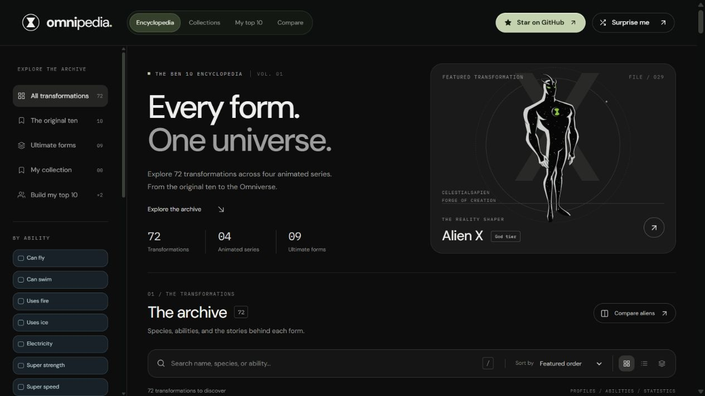
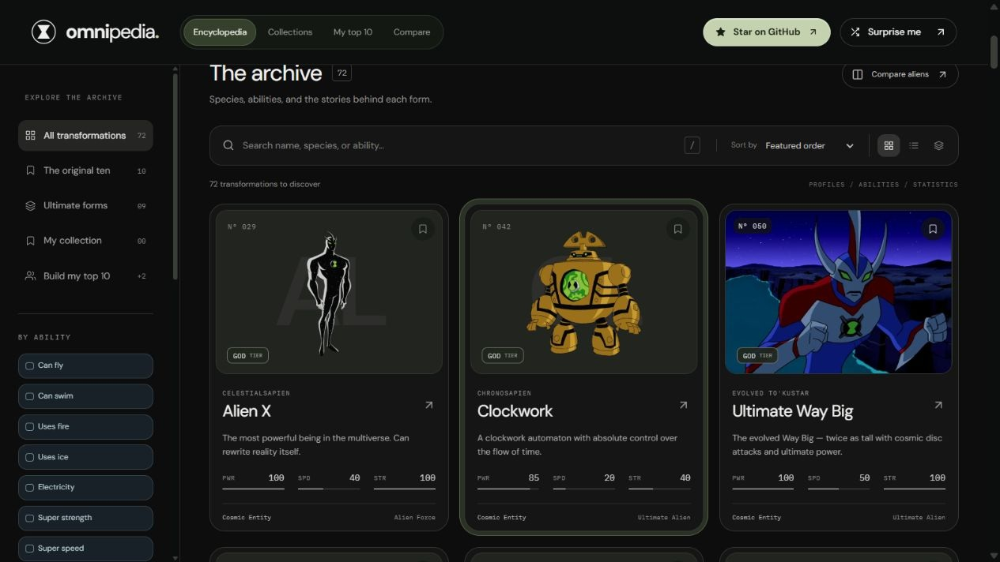
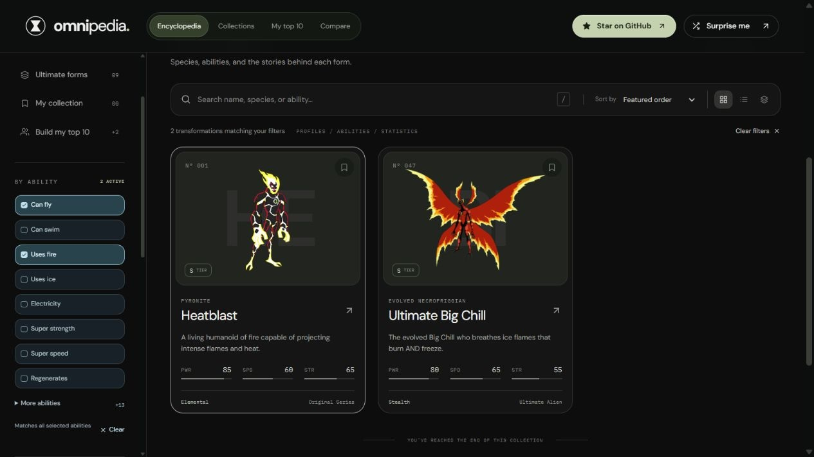
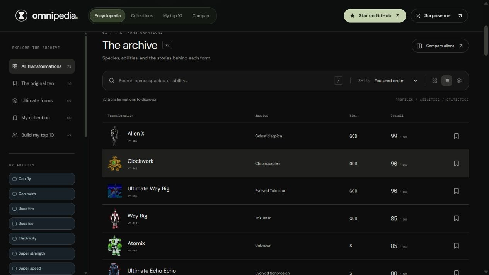
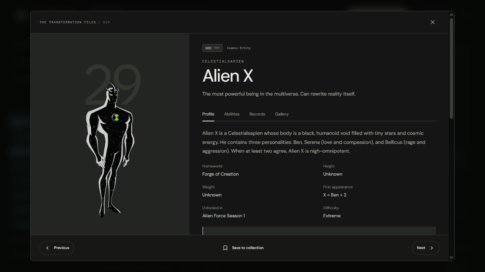
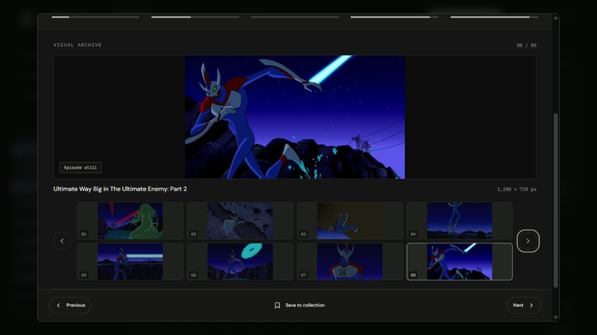
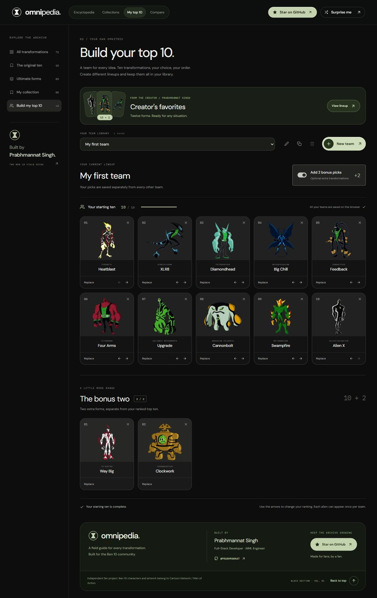
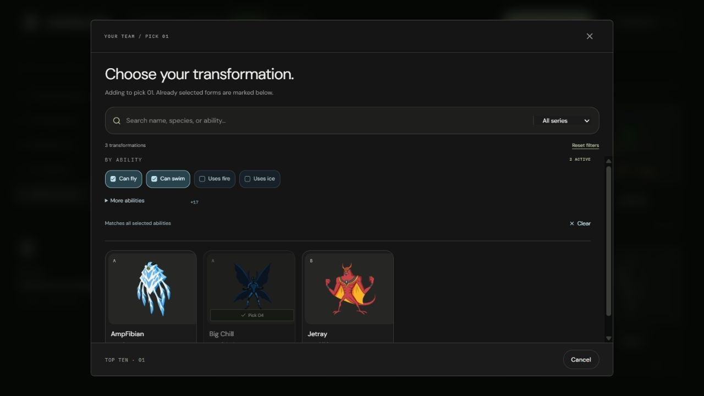
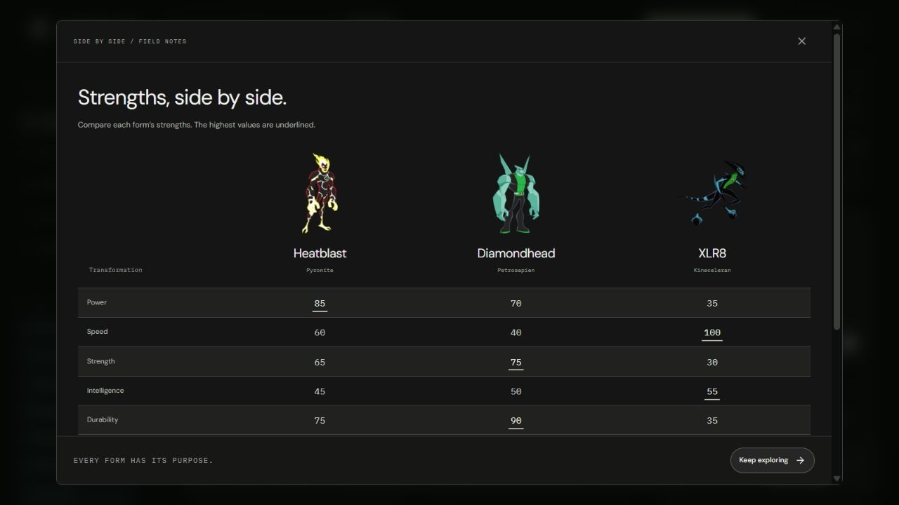
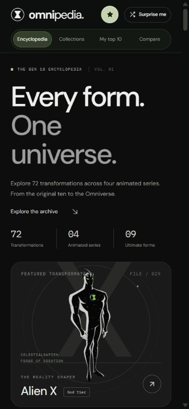

<h1 align="center">omnipedia.</h1>
<p align="center"><strong>THE BEN 10 ENCYCLOPEDIA · BLACK EDITION</strong></p>

<p align="center">
  Every form. One universe.<br />
  A fan-made <strong>React Ben 10 encyclopedia</strong> with 72 transformations, 560 curated images,<br />
  detailed transformation files, comparisons, and your own named Omnitrix lineups.
</p>

<p align="center">
  <a href="https://github.com/PRABHMANNAT/Ben-10-Omnitrix-Database/stargazers">Star on GitHub</a> ·
  <a href="#the-field-guide">Features</a> ·
  <a href="#homepage-tour">Homepage tour</a> ·
  <a href="#see-every-form-in-action">Galleries</a> ·
  <a href="#ten-picks-two-wildcards">Team builder</a> ·
  <a href="#run-it-locally">Quick start</a>
</p>

## The field guide

Browse **72 transformations** across **Original Series, Alien Force, Ultimate Alien, and Omniverse**, including **nine Ultimate forms**. The Black Edition pairs charcoal surfaces, rounded cards, sage highlights, and muted blue ability filters.

| Feature | What you can do |
| :--- | :--- |
| Explore the archive | Search names, species, and abilities; switch between grid, list, and tier views. |
| Find a form for the job | Combine 21 ability filters with series, power tier, classification, and statistics. |
| Read a transformation file | Discover species, homeworld, abilities, weaknesses, first appearance, signature moves, and ten stats. |
| Explore the visual archive | Browse 560 locally hosted images with alternate designs, episode stills, and powers in action. |
| Build your own Omnitrix | Name multiple teams, rank ten aliens, and add two optional bonus picks to each lineup. |
| Compare transformations | Put two or three forms side by side, with the highest statistics highlighted. |
| Save your favorites | Bookmark a personal collection and keep your teams in this browser without an account. |
| Navigate your way | Use responsive layouts, keyboard controls, focus-managed dialogs, and reduced-motion support. |

## Homepage tour

Ten screenshots show the current interface and its main features. Select any image to open the full-size capture.

### 01 / Every form. One universe.

The homepage introduces the archive, its four animated series, and a featured transformation. The sidebar keeps your collection, teams, and filters within reach.

<a href="docs/assets/screenshots/archive.jpg"></a>

### 02 / Browse the cards

Character artwork, species, power tiers, and quick stats make the grid easy to scan. The Aceternity backdrop follows pointer hover and keyboard focus; profile and bookmark buttons work independently.

<a href="docs/assets/screenshots/rounded-interface.jpg"></a>

### 03 / Find a form for the job

Combine **Can fly + Uses fire** to find transformations with both powers. Other filters include swimming, ice, electricity, strength, speed, regeneration, energy absorption, invisibility, phasing, technology, time, gravity, teleportation, and sonic attacks. Search also understands phrases such as **can swim** and **use fire**.

<a href="docs/assets/screenshots/archive-abilities.jpg"></a>

Selections combine with search, series, tier, classification, and stat filters. Matches come from listed abilities; weaknesses and elemental immunities do not grant an active power. “Can swim” includes listed underwater breathing or movement.

### 04 / Switch your perspective

Use the compact list to compare species, tiers, and overall ratings while browsing. Grid and tier views are available from the same toolbar, alongside sorting by name, individual stats, or series.

<a href="docs/assets/screenshots/archive-list.jpg"></a>

## Transformation files

### 05 / Get to know each alien

Open a card for a dedicated dossier. Profile, Abilities, and Records organize the alien's origin, strengths, weaknesses, and appearances. Statistics sit above the image gallery, with previous and next controls for exploring the roster.

<a href="docs/assets/screenshots/profile.jpg"></a>

## See every form in action

### 06 / Explore the visual archive

Scroll below **Statistics**, or choose **Gallery** for quick access. Browse **560 images across all 72 aliens**: most transformations have seven or eight, Alien X has five, and Sandbox and Snakepit have four each. Galleries open on an action shot when one is available.

<a href="docs/assets/screenshots/gallery-expanded.jpg"></a>

Images retain their aspect ratio and load when a gallery opens. Use the four-column thumbnails, image arrows, or **← / →**, **Home**, and **End** while a gallery control is focused. **Full resolution** opens the complete image; **Source & credits** links to the original file page.

The viewer shows actual pixel dimensions. HD episode frames retain their native resolution; smaller artwork is not presented as HD. **Eight smaller images are AI-enhanced** and labeled with their original dimensions and a comparison link. **Sandbox and Snakepit include explicitly labeled non-canon Thomas N. Perkins IV concepts and credited fan interpretations**; Portaler's gameplay and concepts are labeled separately. See the [image sources, credits, and enhancement notes](docs/GALLERY_SOURCES.md).

## Ten picks. Two wildcards.

### 07 / Create your own team library

Open **My top 10**, choose **New team**, and name your lineup. Each team keeps its own ranked ten, two optional bonus picks, and bonus toggle. Switch, rename, duplicate, or delete teams from **Your team library**. Duplicate picks within a lineup are prevented, and rank arrows let you reorder your choices.

<a href="docs/assets/screenshots/team-builder.jpg"></a>

<p align="center"><sub>A sample lineup captured in the app. Your collection and teams are stored in your browser and do not sync across devices.</sub></p>

**Creator's favorites:** explore Prabhmannat Singh's built-in all-situation preset, with **Alien X, Clockwork, Atomix, Feedback, Gravattack, Big Chill, Upgrade, Grey Matter, Swampfire, and XLR8**, plus **Way Big** and **Ultimate Echo Echo** in reserve. Each pick has a role. Expand **Why these twelve?** for strengths and trade-offs, then choose **Make it yours** for an editable copy.

### 08 / Choose the right transformation

Select any team slot to open the picker. Search by name, species, or ability, combine power filters, and narrow candidates by series. Already selected forms are marked so every slot stays unique.

<a href="docs/assets/screenshots/team-picker.jpg"></a>

A team deletion asks for confirmation and keeps at least one personal team available. Existing saved lineups are upgraded automatically.

## Compare transformations

### 09 / Strengths, side by side

Select two or three aliens to compare ten statistics, tiers, and homeworlds in one table. The highest value in each statistic is highlighted so different strengths are easy to spot. Ratings are a fan comparison tool.

<a href="docs/assets/screenshots/comparison.jpg"></a>

## On the go

### 10 / The archive in your pocket

The homepage, navigation, filters, dossiers, galleries, and team builder adapt to smaller screens. On desktop, press **`/`** to search or **`Esc`** to close a dialog. The sliding navigation pill and card backdrop respect reduced-motion preferences.

<p align="center"><a href="docs/assets/screenshots/mobile.jpg"></a></p>

## Run it locally

Use **Node.js 22.12+** and npm. Node.js 24 is also supported.
The Node requirement is declared in `package.json`; `.nvmrc` selects the Node 22 release line.

```bash
git clone https://github.com/PRABHMANNAT/Ben-10-Omnitrix-Database.git
cd Ben-10-Omnitrix-Database
npm ci
npm run dev
```

Open the local URL printed by Vite, usually **http://localhost:5173**. No API keys, environment variables, database, or sign-in are needed.

| Command | Purpose |
| :--- | :--- |
| `npm run dev` | Start the development server with hot reload |
| `npm start` | Alias for the Vite development server |
| `npm run build` | Type-check UI components and build the production site into `dist/` |
| `npm run typecheck` | Check TypeScript UI components without emitting files |
| `npm run preview` | Preview the production build locally |
| `npm run lint` | Check React source, JavaScript utilities, tests, and maintenance scripts with ESLint |
| `npm test` | Run all 27 tests for abilities, team storage, presets, and gallery integrity |
| `npm run test:watch` | Rerun tests while developing |
| `npm run check` | Run lint, tests, and the production build in sequence |

## Deploy on Vercel

Import this GitHub repository into Vercel and use the repository root (`.`) as the **Root Directory**. The committed `vercel.json` supplies these settings:

| Setting | Value |
| :--- | :--- |
| Framework preset | Vite |
| Install command | `npm ci` |
| Build command | `npm run build` |
| Output directory | `dist` |
| Node.js | 24.x recommended; 22.12+ supported |

No environment variables, database, or backend are required. The build checks the typed UI components before bundling. The SPA fallback serves the app on direct navigation; alien links use hash URLs such as `/#alien-x`. All 560 gallery images are included in the static output.

This repository is prepared for deployment; importing it into a Vercel project creates the deployment. See [Vercel’s Vite deployment guide](https://vercel.com/docs/frameworks/frontend/vite).

## React JavaScript project with typed UI components

The application uses **React 19 with JavaScript and JSX**, built by **Vite**. The existing application uses `.jsx` and `.js` files. The Aceternity hover components use TypeScript (`.tsx`), with a typed class-name utility in `.ts`. `index.html` loads `src/main.jsx`, which mounts `App` with React DOM and imports the shared styles. `App.jsx` composes the archive, filters, dialogs, and team builder. Team creation and image galleries load on demand.

`tsconfig.json` checks the typed UI components, while `jsconfig.json` keeps JavaScript/JSX editor support. Both configs and Vite resolve `@/` imports to `src/`. The production build runs `tsc --noEmit` before Vite. ESLint checks JavaScript and TypeScript, React Hooks, Fast Refresh, and Node maintenance scripts. The unused Vite starter styles and logos have been removed.

The archive grid adapts [Aceternity UI’s Card Hover Effect demo](https://ui.aceternity.com/components/card-hover-effect) by Manu Arora. The shared backdrop follows pointer hover and keyboard focus, uses the existing muted palette, and respects reduced-motion preferences. Existing profile, bookmark, and comparison buttons remain independent controls.

- `src/components/card-hover-effect-demo.tsx`: connects the effect to the alien roster.
- `src/components/ui/card-hover-effect.tsx`: reusable typed effect, adapted from the [requested registry source](https://ui.aceternity.com/registry/card-hover-effect-demo.json).
- `src/lib/utils.ts`: shadcn-style `cn()` helper using `clsx` and `tailwind-merge`.
- `components.json`: shadcn-compatible aliases and the `@aceternity` registry; Tailwind v4 remains configured through the Vite plugin and CSS import.

For interface changes, start in `src/components/` and `src/styles/`. Keep reusable filtering, gallery, and team rules in `src/lib/`, with matching `.test.js` files. New tests are discovered by `npm test`. Optional asset download and encoding tools stay in `scripts/`; running the app only needs npm.

## Built with

**React 19 · Vite 7 · TypeScript UI components · Motion / Framer Motion · Tailwind CSS 4 · React Icons**

The interface uses custom CSS, DM Sans, and IBM Plex Mono. Alien illustrations are served from the repository; Google Fonts requires a connection, with system font fallbacks available. Browser `localStorage` keeps your collection and team on the current browser and origin; it does not sync across devices.

```text
src/
├── main.jsx          React DOM entry point and shared style imports
├── App.jsx           Application state, archive views, and composition
├── components/       Archive cards, dossiers, filters, and team builder
├── data/             Alien records and local artwork mappings
├── hooks/            Filtering and dialog behavior
├── lib/              Ability matching, team/gallery rules, and tests
└── styles/           Black Edition design and responsive layouts
public/aliens/        Cached character art and its source manifest
public/gallery/       560 optimized full-resolution gallery images
scripts/              Artwork and gallery cache / encoding utilities
docs/assets/          README banner, custom icons, and app screenshots
components.json       shadcn-compatible UI registry configuration
tsconfig.json         Strict TypeScript checks for the new UI components
jsconfig.json         JavaScript and JSX editor configuration
vercel.json           Vite deployment settings and SPA fallback
vite.config.js        React and Tailwind build plugins
eslint.config.js      Browser React and Node tooling checks
```

<details>
  <summary><strong>Artwork and data notes</strong></summary>

  All 72 records have cover artwork, alongside 560 gallery images. Sandbox and Snakepit use the isolated Thomas N. Perkins IV concepts sourced from Ben 10 Wiki, with non-canon and AI-enhancement labels. Their illustrations appear in archive cards, profiles, comparisons, and team selection. Source references are recorded in [`public/aliens/sources.json`](public/aliens/sources.json); local paths are mapped in [`src/data/artwork.json`](src/data/artwork.json).

  [`scripts/cache-artwork.mjs`](scripts/cache-artwork.mjs) can refresh the cache from its sources and requires internet access. Normal app use does not need to run this script. Treat the numerical ratings as a fan comparison tool. If you spot a lore error, include an episode or reliable source when reporting it.

</details>

## Make the archive better

Ben 10 fans and frontend contributors are welcome. Useful contributions include sourced lore corrections, missing artwork references, accessibility improvements, responsive fixes, and focused interface enhancements.

1. [Open an issue](https://github.com/PRABHMANNAT/Ben-10-Omnitrix-Database/issues) describing the change or bug.
2. Fork the repository and create a branch for one focused change.
3. Run the production build and relevant checks. Include screenshots for visual changes and sources for data corrections.
4. Open a pull request with a short explanation of what changed and why.

Please keep the muted Black Edition visual direction consistent. See the [contribution guide](CONTRIBUTING.md) for file locations and validation tips.

If this is the kind of fan project you want to see grow, **[star the repository](https://github.com/PRABHMANNAT/Ben-10-Omnitrix-Database)** and share it with another Ben 10 fan. Have a favorite lineup? Add a screenshot to a [feature or feedback issue](https://github.com/PRABHMANNAT/Ben-10-Omnitrix-Database/issues).

---

<p align="center">
  Created by <strong><a href="https://github.com/PRABHMANNAT">Prabhmannat Singh</a></strong><br />
  <sub>Full-Stack Developer · AIML Engineer</sub>
</p>

<p align="center">
  <sub>Independent fan project, not affiliated with or endorsed by the Ben 10 rights holders.<br />
  Ben 10 characters and artwork belong to their respective owners, including Cartoon Network and Man of Action.<br />
  No code license is currently declared. Third-party artwork remains the property of its respective owners.</sub>
</p>
